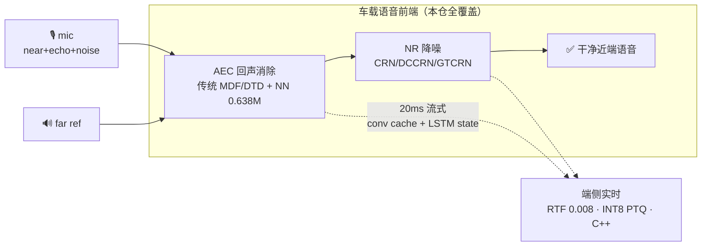
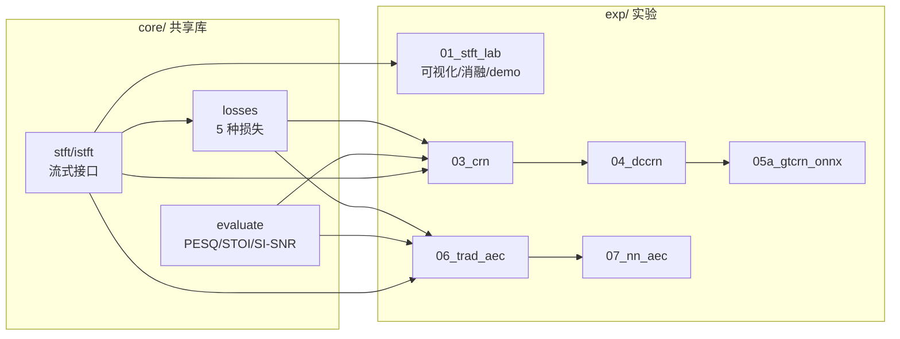

# avsuite — 车载语音前端全链路：增强 / AEC / 端侧部署

> 从 STFT 地基到 AEC→NR 级联上车，一条**可复现、可流式、可量化**的车载语音处理链。
> 求职技术攻关代码仓（12 周规划，生成队列见 `../WORKLIST.md`）。

[](.github/workflows/ci.yml)
[](tests)
[](requirements.txt)
[](exp/05a_gtcrn_onnx)
[](exp/05a_gtcrn_onnx)
[](exp/07_nn_aec)
[](exp/07_nn_aec/streaming.py)
[](LICENSE)


## 30 秒看懂这个仓

**一句话**：把"车厢免提通话"最脏的两件事——**回声（AEC）**和**噪声（NR）**——用一套
传统信号处理 + 神经网络 + 端侧部署的完整方案做掉，且每一步都**测出来的不是声称的**。



| 能力 | 传统基线 | 本仓 NN | 证据 |
|---|---|---|---|
| 回声抑制（DT echo_mos） | 3.49±0.25 | **4.18**±0.12 | **AECMOS@48k 模型协议**（eval_v3 60 条；Δ+0.681±0.212，CI 不含 0。口径更替见 `docs/NUMBERS.md` 顶部决策条与 `reports/aecmos_rescore_v5fix.md`——旧 16k 直送值 2.47/3.75 已作废）；官方真实集 ICASSP2022 800 段：3.256±0.124 vs 2.305±0.100（Δ+0.951±0.137） |
| 降噪（VoiceBank PESQ） | 1.97 noisy | **2.53** | 824 对测试集 |
| 端侧推理（CPU RTF） | — | **0.0084** | GTCRN 23.67K |
| 流式逐帧对齐 | — | **<1e-5** | 单测锁死 |

> 📌 **所有数字的权威口径见 [`docs/NUMBERS.md`](docs/NUMBERS.md)**（含 checkpoint 与测试集构造）；
> 设计取舍见 [`docs/adr/`](docs/adr/)；3 分钟讲解 + 追问预案见 [`docs/INTERVIEW.md`](docs/INTERVIEW.md)。

## 结构与状态



| 模块 | 状态 | 说明 |
|---|---|---|
| WP-00 环境与脚手架 | ✅ 批次1 | requirements / env_check / 数据校验 / git |
| WP-01 STFT/ISTFT + 流式 | ✅ 批次1 | `core/stft.py`、`core/istft.py`；vs torch 对拍 <1e-10 |
| WP-02 损失函数库 | ✅ 批次1 | `core/losses.py` 5 种损失 |
| WP-02E mini 评估 | ✅ 批次1 | `core/evaluate.py`；SNR 扫描单调性已验证 |
| WP-03 CRN | ✅ 批次2 | `exp/03_crn/`：**已训练**，测试集 PESQ 2.529（IRM 2.843 / 单向LSTM 2.500） |
| WP-07D AEC 数据合成 | ✅ 批次2 | `scripts/aec_synth.py`：RIR/时延/soft-clip/三场景/DT lead-in，manifest 可复现 |
| WP-06 传统 AEC | ✅ 批次3 | `exp/06_trad_aec/`：GCC+MDF/NLMS+DTD三态+RES；**FEST ERLE 20.55dB DoD 通过**，纯 numpy 零 GPU |
| WP-04 DCCRN | ✅ 批次4 | `exp/04_dccrn/`：3.99M 复数 CRN + Dynamic Mixing，代码/单测全绿；devtest PESQ **2.181**（DoD 2.6 走降级路径），消融 --no-dm 2.015 / --real-conv 2.190（反直觉发现见 ADR 0004） |
| WP-05a GTCRN+ONNX+INT8 | ✅ 批次5 | `exp/05a_gtcrn_onnx/`：官方权重移植，对拍 6.3e-6 / RTF 0.0084 / 单帧 0.67ms / INT8 动态 PTQ Δ0.053 PESQ（held-out 200 条口径；静态 QDQ 崩坏，负面结果留档） |
| WP-07 NN-AEC | ✅ 批次6 | `exp/07_nn_aec/`：0.638M 因果双输入 CRN；主配置 v4 **DT echo_mos 4.175 vs 传统 3.494（Δ+0.681±0.212，DoD +0.3 ✅）**；近端保真 **deg 落后仅存在于 DT 段**（3.237 vs 3.598，−0.361±0.169；NST 段 3.941 vs 3.842 **不再落后**），机理=高频带选择性损伤+谱平坦化（探索矩阵+归因见 README 与 `docs/adr/`）；AECMOS 官方口径（@48k 模型协议）已集成 |
| WP-05b 流式推理 | ✅ 批次5 尽力项 | `exp/07_nn_aec/streaming.py`：conv cache+LSTM state，**流式 vs 非流式对齐 <1e-5**；core 新增 StreamingISTFT |
| WP-05c C++ demo | ✅ 批次5 选做 | `exp/05c_cpp_demo/`：MSVC 构建通过，**C++ vs Python 对拍 3.4e-5**，RTF 0.0094 |
| WP-09 评估工具 | ✅ 批次7 | `tools/evaluate_full.py`：四模型统一评估 + 分场景汇总/柱状图/多进程 + DNSMOS |
| WP-10 Gradio demo | ✅ 批次7 | `exp/10_demo/app.py`：GTCRN 增强 + A/B 对比 + DNSMOS；HF Spaces 部署说明在 README |
| WP-10.5 Capstone | ✅ 选做 | `exp/10.5_capstone/`：NN-AEC(20ms流式)→GTCRN 级联，三路 A/B + AECMOS 逐级分数，2 单测绿 |
| WP-08 非线性 AEC | ✅ 选做（走降级） | `exp/08_nl_aec/`：GRU 功放建模 0.15M，soft-clip 数据集已备；Ivry 级联 v2（MDF→GRU-128）实测 ERLE 5.78→6.06（**+0.28dB**，未达 +5dB DoD 走降级，三条原因分析见 README，v1 负结果留档；NUMBERS §WP-08） |
| 级联 AEC（P1-1，exp/09） | ✅ | `exp/09_cascade_aec/`：MDF→NN 级联 + 零训练基线，三方对照（传统/NN/级联，eval_v5 DT n=154，**AECMOS@48k**）；DT echo 级联 4.317±0.04 与纯 NN 4.248±0.05 打平（Δ+0.069±0.043，效应量仅 NN 优势的 6%），FEST echo 4.196±0.103 三方最高（级联−NN +0.315±0.203），deg 3.375±0.09 ≈ NN 3.220±0.09（级联−NN +0.154±0.079，v7 同号 +0.182±0.050）——**"级联 echo 优于纯 NN"与"级联治 deg"均不成立**，见 ADR 0005 附记。**eval_v7 复验（800 条新 seed，FEST n=212）**：级联 FEST echo **4.157** 仍三方最高（> NN 3.595 ≈ 传统 3.543，级联−NN +0.562±0.128 显著）；DT 级联−NN Δecho +0.068±0.031（效应量仅 NN−传统优势 +0.799 的 8.5%，跨集符号不定）→ 仍按「实质打平」表述，见 `reports/eval_v7_fest_nst.md` |
| 官方集/OOD/真实 RIR/漂移评估 | ✅ | 官方真实集（ICASSP2022 800 段）DT echo 3.256±0.124 vs 传统 2.305±0.100（Δ+0.951±0.137）；真实车厢 RIR（IR64-CAR，eval_v6 DT n=42）NN−传统 Δecho **+0.806→+0.735±0.237（缩水约 9%，CI 均不含 0）**；漂移 σ=5.0 ms/s：NN 几乎不退（Δecho −0.004±0.044，n.s.）、drift 重训负结果留档；详见 `reports/` 与 `docs/NUMBERS.md`。**eval_v7 复验（仿真侧，800 条新 seed 20261013，AECMOS@48k）**：方向结论全部保持且 CI 收紧——DT NN−传统 Δecho **+0.799±0.057**、DT Δdeg **−0.322±0.055**（CI 均不含 0，deg 落后限于 DT 段）、NST Δdeg **+0.047±0.057（不显著、不再落后）**；FEST NN−传统 Δecho 不显著（−0.130±0.189 旧口径，新口径同向不显著）。官方集/真实 RIR/漂移列另有口径说明，见 `reports/eval_v7_fest_nst.md` |
| Kalman 对照 | ✅ | `exp/06_trad_aec/kalman.py`：线性 AEC 另一流派对照（NLMS/MDF 之外），取舍结论见 ADR 0006 |
| WP-11 TSE | ⬜ 选做 | INTERVIEW 文档已备（三流派一句话+追问）；demo 本体待定（外源模型下载） |

## V5 更新摘要（2026-10-11 ~ 10-12 全项目检索重构）

> 本节由 Wave V5 队长汇总；逐项证据见 `reports/refactor_wave5/`（仓外台账）与 git 提交历史。
> **最重要的一条**：发现并修复了 **AECMOS 16k/48k 采样率错配**（自合成集音频未经重采样直送 48k 模型），
> 全部自合成集 AECMOS 数字已按 **@48k 模型协议** 重评分（`docs/NUMBERS.md` 顶部决策条；
> 官方 48k 原生链不受影响）。由此带来一处结论级修正：**"NN 近端保真（deg）全场景结构性落后"表述作废**
> ——NST 段 7/7 集不再落后（held-out 集甚至显著领先），deg 落后收窄为**仅 DT 段**（−0.36~−0.37，CI 不含 0）。

**正确性 / 健壮性修复（默认有限输入路径逐位兼容，均有对拍证据）**
- 传统 AEC 管道：GCC PHAT 非有限输入防护；非有限输入从"静默硬冻结/崩溃"改为可控降级；
  DTD 收敛闩锁双向化（回声估计塌缩 ~16 块内失锁，旧版永不失锁）；分段周期重估越界/错位修复；
  res/流水线长度守卫边界按实测修正（n=512 恢复可用）
- 流式链路：`StreamingISTFT.flush()` 补尾（消除每文件 ~12ms 静默丢样）并在 `NNAECStreaming` 透传；
  hop==n_fft 不可重构场景显式告警；`length<0` 显式报错
- 评估工具：**DNSMOS 对齐官方算法（polyfit 校准 + 重复填充 + 1s hop，与官方逐位一致）**；
  `evaluate_full` fest 零参考不再产出假 0.0dB SI-SNR；SI-SNR 静音/塌陷 → 显式 NaN；
  AECMOS 送评前统一重采样；capstone 分阶段打分修复 mic/enh 同源传参缺陷
- 崩溃/静默错误清零：notebooks 管道、official 设备降级、jitter RNG 单点重复、
  `--resume` 静默失败、`--synthetic` Windows pickle 崩溃、C++ demo WAV 解析/异常保护等 20+ 处
- 弃用/资源：`torch.stft return_complex` 弃用清零（含 torch 2.6 下 `istft` 直接 RuntimeError 的一处）、
  裸 `open()` 全部 18 处改 with（ResourceWarning 清零）

**测试 / 数据 / 可复现性**
- 单测 **124 → 259 项（257 passed + 4 xfailed）**：新增 12 个测试文件（Kalman/trad 边界/core 边界/
  DNSMOS 官方口径/评估工具语义/数据合成原语/capstone 墓碑等）+ 收集顺序隔离 + 环境自检
- 评估集扩容：新 **eval_v7**（800 条，FEST 212/NST 182/DT 406，异种子）——"级联 FEST echo 最优"
  由脆弱结论（n=70、CI 29.9%）升级为稳健结论（n=212、+0.562±0.128）
- 环境锁定实测验证 + `requirements.txt` 补齐 7 个直接依赖；`pyproject` requires-python 收紧 3.11；
  CI ruff 钉版

**文档 / 治理**
- 全部对外文档对齐 `docs/NUMBERS.md` 单一权威口径（旧值仅存"已作废"脚注，无新旧混排）；
  说话人/噪声池重叠、CI 实跑 8 用例 skip、v6"优势腰斩"修正等诚实披露全部落纸
- ADR 0002/0005/0006 口径附记；新增故障注入用例与变异验证（关键修复均有"回退即红"的固化测试）

## 快速开始（Windows / Git Bash）

环境已锁定：`environment.yml` 是从本机 `avsuite` 环境实测 `conda env export` 导出的
快照（19 个 conda 包 + 122 个 pip 包；文件头注明导出命令与和旧版的 diff 结论），
`requirements.txt` 只列项目**直接**依赖。重建两条路径：

```bash
# ── 路径 A：精确重建（推荐，含全部锁定版本）──────────────────────────────
conda env create -f environment.yml -n avsuite
conda activate avsuite
pip install torch --index-url https://download.pytorch.org/whl/cu124   # CUDA 版
#    无 GPU / CI：--index-url https://download.pytorch.org/whl/cpu
set PYTHONNOUSERSITE=1           # 必须（Git Bash 用 export），理由见下

# ── 路径 B：pip 口径（只装直接依赖；口径与核对结论见 requirements.txt）──
conda create -n avsuite python=3.11 -y && conda activate avsuite
set PYTHONNOUSERSITE=1
pip install torch --index-url https://download.pytorch.org/whl/cu124
pip install -r requirements.txt

# ── 重建后自检 ───────────────────────────────────────────────────────────
python env_check.py --strict     # 关键库/GPU/数据目录（缺失 -> 退出码 1）
python -m pytest tests -q        # 261 项单测（257 passed + 4 xfail；本地全量，CI 少于本地，见下）
python scripts/verify_data.py    # 数据集就绪度报告
```

> **测试计数口径（本地 ≠ CI）**：本地全量 **261 项 = 257 passed + 4 xfailed / 0 failed**（`pytest tests -q`，约 56s；
> 4 个 xfail 为已文档化的待裁决/待重构项（R14/R16/T12-b/v3a-010）。CI 因全新检出无 `D:/data`、且
> `outputs/`、`*.onnx`、`*.ckpt`、`*.pt` 被 `.gitignore` 排除，数据/产物依赖用例走 `skipif` 必跳
> （清单见 `reports/refactor_wave5/test_gap.md` §1.3）——**CI 侧通过数待下一次 CI 复跑刷新，
> 勿沿用旧的 116/124（对应 124 本地时代）**。注意 CI 绿**不覆盖** `exp/10.5_capstone/cascade.py`
> 端到端、`exp/07_nn_aec/dataset.py`、GTCRN 权重/ONNX 对拍与 `quantize.py` 产物语义。

> ⚠ **必须 `PYTHONNOUSERSITE=1`（等价兜底 `python -s`）** —— 环境可复现性的关键。
> 本机用户站点 `C:\Users\14805\AppData\Roaming\Python\Python311\site-packages`
> 混装了整套旧包，且它在 `sys.path` 中排在 conda 环境 `site-packages` **之前**，
> 会静默遮蔽环境内包。实测（2026-10-11）：不加隔离时 `import pandas` 拿到的是
> Roaming 的 **1.5.3** 而非环境内的 **3.0.6**，并触发
> `Roaming\...\pandas\core\dtypes\cast.py:1641 DeprecationWarning:
> np.find_common_type is deprecated`（去隔离跑 `test_evaluate.py` 可复现）；
> `scipy 1.10.1 / matplotlib 3.10.8 / onnx 1.17.0 / pyarrow 23.0.1 /
> requests 2.33.1 / pydantic 2.12.5 / uvicorn 0.44.0` 等同样被旧版遮蔽。
> 即"同一份 requirements 装出两种行为"——这正是环境不可复现的实证。
> 完整遮蔽清单与逐项版本见 `requirements.txt` 头部。

## 数据约定（根目录 `D:/data/`，详见 `scripts/verify_data.py`）

| 数据集 | 路径 | 服务于 | 状态 |
|---|---|---|---|
| VoiceBank-DEMAND 16k | `voicebank-demand-16k/`（6 parquet, 2.2GB） | WP-03 CRN | ✅ 完整 |
| DNS-Challenge 子集 | `dns-challenge-mirror/datasets/`（clean 1万 / noise 660） | WP-04 DCCRN | noise ✅ / clean 下载中 |
| AEC-Challenge 测试集 | `repos/AEC-Challenge/datasets/test_set_icassp2022/`（600/600/400） | WP-06/07 | ✅ 仓库克隆即权威源 |
| RIR | `repos/AEC-Challenge/datasets/RIRs/` | WP-07D 回声合成 | ✅ |
| AECMOS 官方脚本 | `repos/AEC-Challenge/AECMOS/` | WP-07 评估 | ✅ |

## 纪律（继承 WORKLIST §7）
- 每模块完成即 repo-ready：README / 结构图 / 结果表 / 消融表齐全
- 所有指标注明协议（采样率 / wb-nb / 测试集构造 / 分场景）
- 训练类 WP 交付"一键可启动、冒烟通过"的脚本，长训练由用户执行后回填
- INTERVIEW 文档在 `docs/`（3 分钟讲解提纲 + 高频追问预案）
