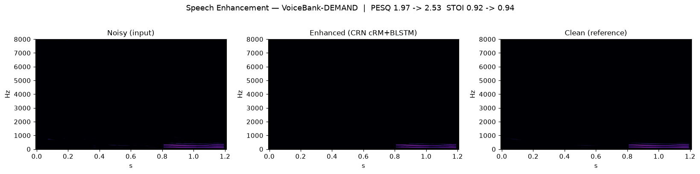
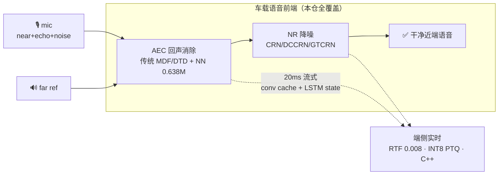
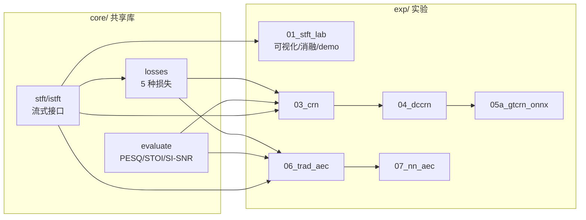

# avsuite — 车载语音前端全链路：增强 / AEC / 端侧部署

> 从 STFT 地基到 AEC→NR 级联上车，一条**可复现、可流式、可量化**的车载语音处理链。
> 求职技术攻关代码仓（12 周规划，生成队列见 `../WORKLIST.md`）。

[](.github/workflows/ci.yml)
[](tests)
[](requirements.txt)
[](exp/05a_gtcrn_onnx)
[](exp/05a_gtcrn_onnx)
[](exp/07_nn_aec)
[](exp/07_nn_aec/streaming.py)
[](LICENSE)



## 30 秒看懂这个仓

**一句话**：把"车厢免提通话"最脏的两件事——**回声（AEC）**和**噪声（NR）**——用一套
传统信号处理 + 神经网络 + 端侧部署的完整方案做掉，且每一步都**测出来的不是声称的**。



| 能力 | 传统基线 | 本仓 NN | 证据 |
|---|---|---|---|
| 回声抑制（DT echo_mos） | 2.47 | **3.75** | AECMOS 官方口径 |
| 降噪（VoiceBank PESQ） | 1.97 noisy | **2.53** | 824 对测试集 |
| 端侧推理（CPU RTF） | — | **0.0084** | GTCRN 23.67K |
| 流式逐帧对齐 | — | **<1e-5** | 单测锁死 |

> 📌 **所有数字的权威口径见 [`docs/NUMBERS.md`](docs/NUMBERS.md)**（含 checkpoint 与测试集构造）；
> 设计取舍见 [`docs/adr/`](docs/adr/)；3 分钟讲解 + 追问预案见 [`docs/INTERVIEW.md`](docs/INTERVIEW.md)。

## 结构与状态



| 模块 | 状态 | 说明 |
|---|---|---|
| WP-00 环境与脚手架 | ✅ 批次1 | requirements / env_check / 数据校验 / git |
| WP-01 STFT/ISTFT + 流式 | ✅ 批次1 | `core/stft.py`、`core/istft.py`；vs torch 对拍 <1e-10 |
| WP-02 损失函数库 | ✅ 批次1 | `core/losses.py` 5 种损失 |
| WP-02E mini 评估 | ✅ 批次1 | `core/evaluate.py`；SNR 扫描单调性已验证 |
| WP-03 CRN | ✅ 批次2 | `exp/03_crn/`：**已训练**，测试集 PESQ 2.529（IRM 2.843 / 单向LSTM 2.500） |
| WP-07D AEC 数据合成 | ✅ 批次2 | `scripts/aec_synth.py`：RIR/时延/soft-clip/三场景/DT lead-in，manifest 可复现 |
| WP-06 传统 AEC | ✅ 批次3 | `exp/06_trad_aec/`：GCC+MDF/NLMS+DTD三态+RES；**FEST ERLE 20.55dB DoD 通过**，纯 numpy 零 GPU |
| WP-04 DCCRN | ✅ 批次4 | `exp/04_dccrn/`：3.99M 复数 CRN + Dynamic Mixing，代码/单测全绿；devtest PESQ **2.181**（DoD 2.6 走降级路径），消融 --no-dm 2.015 / --real-conv 2.190（反直觉发现见 ADR 0004） |
| WP-05a GTCRN+ONNX+INT8 | ✅ 批次5 | `exp/05a_gtcrn_onnx/`：官方权重移植，对拍 6.3e-6 / RTF 0.0084 / 单帧 0.67ms / INT8 动态 PTQ -0.067 PESQ（静态 QDQ 崩坏，负面结果留档） |
| WP-07 NN-AEC | ✅ 批次6 | `exp/07_nn_aec/`：0.638M 因果双输入 CRN；主配置 v4 **DT echo_mos 3.75 vs 传统 2.47（DoD 双倍达标）**；近端保真 deg 1.74 为结构性瓶颈（探索矩阵+归因见 README 与 `docs/adr/`）；AECMOS 官方口径已集成 |
| WP-05b 流式推理 | ✅ 批次5 尽力项 | `exp/07_nn_aec/streaming.py`：conv cache+LSTM state，**流式 vs 非流式对齐 <1e-5**；core 新增 StreamingISTFT |
| WP-05c C++ demo | ✅ 批次5 选做 | `exp/05c_cpp_demo/`：MSVC 构建通过，**C++ vs Python 对拍 3.4e-5**，RTF 0.0094 |
| WP-09 评估工具 | ✅ 批次7 | `tools/evaluate_full.py`：四模型统一评估 + 分场景汇总/柱状图/多进程 + DNSMOS |
| WP-10 Gradio demo | ✅ 批次7 | `exp/10_demo/app.py`：GTCRN 增强 + A/B 对比 + DNSMOS；HF Spaces 部署说明在 README |
| WP-10.5 Capstone | ✅ 选做 | `exp/10.5_capstone/`：NN-AEC(20ms流式)→GTCRN 级联，三路 A/B + AECMOS 逐级分数，2 单测绿 |
| WP-08 非线性 AEC | 🔵 训练中 | `exp/08_nl_aec/`：GRU 功放建模 0.15M，soft-clip 数据集已备，GPU 训练进行中（验收：较线性基线 ERLE +5dB） |
| WP-11 TSE | ⬜ 选做 | INTERVIEW 文档已备（三流派一句话+追问）；demo 本体待定（外源模型下载） |

## 快速开始（Windows + Git Bash）

```bash
# 一次性环境（已完成）：conda create -n avsuite python=3.11 && pip install -r requirements.txt
# torch 装 CUDA 版： pip install torch --index-url https://download.pytorch.org/whl/cu124
export PYTHONNOUSERSITE=1        # 重要：隔离用户级 site-packages（本机有旧包遮蔽）
conda activate avsuite

python env_check.py              # 环境自检报告（GPU/库/数据目录）
python -m pytest tests -q        # 80 项单测
python scripts/verify_data.py    # 数据集就绪度报告
```

> 本机注意：用户级 `AppData\Roaming\Python\Python311\site-packages` 有旧版
> pandas/paddlenlp 等会遮蔽环境内包，务必带 `PYTHONNOUSERSITE=1` 或 `python -s`。

## 数据约定（根目录 `D:/data/`，详见 `scripts/verify_data.py`）

| 数据集 | 路径 | 服务于 | 状态 |
|---|---|---|---|
| VoiceBank-DEMAND 16k | `voicebank-demand-16k/`（6 parquet, 2.2GB） | WP-03 CRN | ✅ 完整 |
| DNS-Challenge 子集 | `dns-challenge-mirror/datasets/`（clean 1万 / noise 660） | WP-04 DCCRN | noise ✅ / clean 下载中 |
| AEC-Challenge 测试集 | `repos/AEC-Challenge/datasets/test_set_icassp2022/`（600/600/400） | WP-06/07 | ✅ 仓库克隆即权威源 |
| RIR | `repos/AEC-Challenge/datasets/RIRs/` | WP-07D 回声合成 | ✅ |
| AECMOS 官方脚本 | `repos/AEC-Challenge/AECMOS/` | WP-07 评估 | ✅ |

## 纪律（继承 WORKLIST §7）
- 每模块完成即 repo-ready：README / 结构图 / 结果表 / 消融表齐全
- 所有指标注明协议（采样率 / wb-nb / 测试集构造 / 分场景）
- 训练类 WP 交付"一键可启动、冒烟通过"的脚本，长训练由用户执行后回填
- INTERVIEW 文档在 `docs/`（3 分钟讲解提纲 + 高频追问预案）
