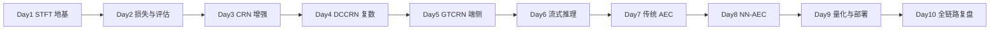

# LEARNING.md — 从 0 复现本仓的 10 天学习路径

> 把这份仓库当成你自己的"教科书"。每天给出：**读哪几个文件 → 跑哪条命令 → 应该看到什么 →
> 自检问题**。按顺序走，约 10 天（每天 1.5~3h）能把全仓吃透。
> 环境：见根 README「快速开始」，`conda activate avsuite` + `PYTHONNOUSERSITE=1`。

---

## 🗺 路线图总览

---

## Day 1 — STFT/ISTFT 地基（一切的根）
- **读**：`core/stft.py`、`core/istft.py`、`docs/INTERVIEW-WP01-STFT.md`
- **跑**：`python -m pytest tests/test_stft.py -q`；`python exp/01_stft_lab/visualize.py`
- **应看到**：8 项单测全绿；`outputs/stft_viz.png` 四图（幅度/相位/实部/虚部）
- **自检**（白板默写）：① STFT 定义式；② 什么是 COLA；③ 为什么相位不能直接 MSE 回归；
  ④ 流式 STFT 的 lookahead 哪来的（n_fft-hop=16ms）。

## Day 2 — 损失函数 + 评估口径
- **读**：`core/losses.py`、`core/evaluate.py`、`docs/INTERVIEW-WP02-losses.md`
- **跑**：`python -m pytest tests/test_losses.py tests/test_evaluate.py -q`
- **应看到**：SI-SNR 零均值化、γ=0 退化为 MSE 的单测通过
- **自检**：① SI-SNR 三步（去直流→投影→能量比）；② IRM 公式；③ 报指标为什么要带口径。

## Day 3 — CRN：第一个完整 NN 增强闭环
- **读**：`exp/03_crn/model.py`、`train.py`、`docs/INTERVIEW-WP03-CRN.md`
- **跑**：`python exp/03_crn/train.py --smoke`（冒烟，不训练）；看 `outputs/eval/best/summary.json`
- **应看到**：编码 3 层 conv（F:257→33）+ BLSTM + 对称解码 + cRM；已训练结果 PESQ 2.53
- **自检**：① cRM 和 IRM 的区别（相位）；② 编码器每层 F 怎么算 (F-1)//2+1；③ BLSTM vs 单向 LSTM 的因果性。

## Day 4 — DCCRN：复数域的得与失
- **读**：`exp/04_dccrn/complex_nn.py`、`dynamic_mixing.py`、`docs/adr/0004-dccrn-real-vs-complex.md`
- **跑**：`python exp/04_dccrn/param_check.py`
- **应看到**：复数乘法 (a+bi)(c+di) 的 Re/Im 两路线性组合；参数量 3.99M
- **自检**：① 复数卷积为什么要 4 次实卷积；② Dynamic Mixing 的 SNR 公式；③ **为什么 real-conv
  反超复数**（ADR 0004，面试必问）。

## Day 5 — GTCRN：端侧轻量化的艺术
- **读**：`exp/05a_gtcrn_onnx/gtcrn.py`、`README.md`、`docs/INTERVIEW-WP05a-GTCRN-ONNX.md`
- **跑**：`python -m pytest tests/test_gtcrn_onnx.py -q`
- **应看到**：ERB 频带压缩（257→129）+ DPGRNN；参数量 23.67K
- **自检**：① ERB 为什么能当轻量化折中；② 23.67K 参数花在哪；③ 对拍 6.3e-6 怎么测的。

## Day 6 — 流式推理：因果是测出来的
- **读**：`exp/07_nn_aec/streaming.py`、`core/stft.py` 的 `StreamingSTFT`
- **跑**：`python -m pytest tests/test_streaming_nnaec.py -q`
- **应看到**：conv cache（每层 5 帧）+ LSTM state 外置；流式 vs 非流式 <1e-5
- **自检**：① conv 左 pad、deconv 右移 2 帧为什么保因果；② cache 内存为什么有界（~270KB）；
  ③ 单测怎么"锁死"因果性。

## Day 7 — 传统 AEC：全仓技术含量最高
- **读**：`exp/06_trad_aec/pipeline.py`、`dtd.py`、`mdf.py`、`docs/adr/0001-dtd-mic-vs-yecho-coherence.md`
- **跑**：`python -m pytest tests/test_trad_aec.py -q`
- **应看到**：GCC-PHAT → MDF → DTD 三态状态机 → RES
- **自检**：① NLMS 更新方程；② 为什么用 mic-vs-y_echo 相干而非时域相关（ADR 0001）；
  ③ 收敛闩锁解决什么鸡生蛋问题。

## Day 8 — NN-AEC：简历核心
- **读**：`exp/07_nn_aec/model.py`、`README.md`、`docs/adr/0002-fullnn-vs-cascade-aec.md`
- **跑**：看 `outputs/eval/v4/summary.json` 和 `outputs/aecmos_nn_v4.json`
- **应看到**：双输入 4 通道、0.638M、DT echo_mos 3.75 vs 传统 2.47、deg 1.74 未达标
- **自检**：① 为什么 echo 赢 deg 输；② 生产为什么回级联（ADR 0002）；③ 时延鲁棒三层防御。

## Day 9 — 量化与部署：负面结果最值钱
- **读**：`exp/05a_gtcrn_onnx/quantize.py`、`docs/adr/0003-gtcrn-static-int8-collapse.md`、`exp/05c_cpp_demo`
- **跑**：`python exp/05a_gtcrn_onnx/quantize.py --mode dynamic`（若已配置）
- **应看到**：dynamic -0.067 可用 / static -0.75 崩坏
- **自检**：① 静态 QDQ 为什么崩（三要素）；② PTQ vs QAT；③ C++ 端侧推理的 FFT/reflect 填充坑。

## Day 10 — 全链路复盘（输出倒逼输入）
- **做**：① 合上代码，白板画出 AEC→NR 级联全流程；② 背 [`docs/STORY.md`](STORY.md) 90 秒版；
  ③ 扫 [`docs/CHEATSHEET.md`](CHEATSHEET.md)；④ 把 4 篇 ADR 的"面试标准答案"各讲一遍。
- **自检**：能否不看代码讲清"一个带回声带噪的 mic 信号，怎么一步步变成干净近端"。

---

## 配套交互教程（notebooks/）
| Notebook | 主题 | 动手点 |
|---|---|---|
| `notebooks/01_stft.ipynb` | STFT/窗 | 调窗长窗型实时看语谱 |
| `notebooks/02_aec.ipynb` | 传统 AEC | 逐块看 MDF 收敛 + DTD 状态机 |
| `notebooks/03_masks.ipynb` | 掩码 | IRM vs cRM 可视化对比 |

## 学习纪律
- **每个数字都要能复现**——看到一个指标，先找它在 `docs/NUMBERS.md` 的出处和 checkpoint；
- **读懂再合入**——LLM 生成代码逐行读懂，核心模块（STFT/DTD/因果）白纸手写自检；
- **坑比数字值钱**——每个模块的"已知坑"小节是面试差异化弹药，优先精读。
