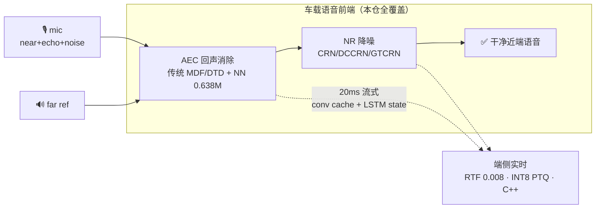

# 30 秒看懂 avsuite

**一句话**：把车厢免提通话最脏的两件事——**回声（AEC）**和**噪声（NR）**——用一套
传统信号处理 + 神经网络 + 端侧部署的完整方案做掉，且每一步都**测出来的不是声称的**。

## 核心数字

| 能力 | 传统基线 | 本仓 NN | 证据 |
|---|---|---|---|
| 回声抑制（DT echo_mos） | 2.47 | **3.75** | AECMOS 官方口径 |
| 降噪（VoiceBank PESQ） | 1.97 noisy | **2.53** | 824 对测试集 |
| 端侧推理（CPU RTF） | — | **0.0084** | GTCRN 23.67K |
| 流式逐帧对齐 | — | **<1e-5** | 单测锁死 |
| 单元测试 | — | **80 passed** | `pytest tests -q` |

> 数字权威口径 → [NUMBERS.md](NUMBERS.md)；90 秒项目叙事 → [STORY.md](STORY.md)。
